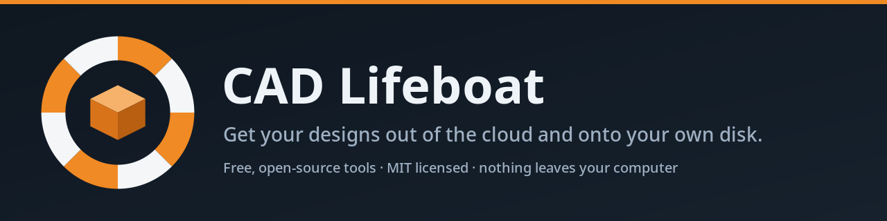

Free, open-source tools for keeping your own copies of your CAD work. Everything runs on your computer, and nothing in your account is changed.

| Tool | What it does |
|---|---|
| [**Fusion Bulk Export**](https://github.com/cad-lifeboat/fusion-bulk-export) | A Fusion add-in that saves every design in your account (or the projects and folders you pick) as `.f3d` plus STEP, in the same folder layout. Resumable, macOS and Windows. [Download](https://github.com/cad-lifeboat/fusion-bulk-export/releases/latest) |

Not affiliated with or endorsed by Autodesk or any CAD vendor. Product names are trademarks of their owners.
